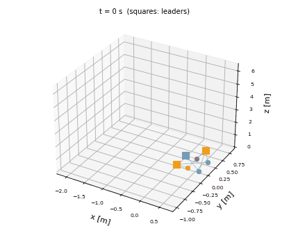
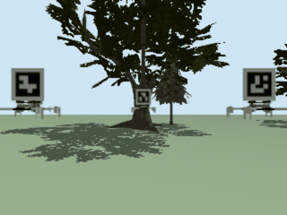

# Bearing Estimation on S² for UAV Formations: Gazebo Simulation

ROS 2 and Gazebo simulation based on the paper *Bearing Estimation on S² via Tangent-Space Measurements for UAV Formation Control* (CCE 2026). Seven Crazyflie quadrotors fly in formation using only what each camera sees. Three leaders follow a trajectory, and four followers keep their place using bearings to ArUco markers. A Kalman filter or an H-infinity filter on the tangent space of the sphere estimates each bearing and its rate.




This repository is based on the simulation of the paper, but it is not the same code. See [Differences from the paper](#differences-from-the-paper).

## What you need

- A computer with **Ubuntu 24.04**. ROS 2 Jazzy does not support other versions directly.
- A dedicated GPU is recommended, because seven cameras are rendered at once. A flight was developed on an Intel i7-14650HX with an NVIDIA RTX 4070.
- About 10 GB of free disk space.

You do not need to know ROS or Python to run it. Copy each block into a terminal (`Ctrl+Alt+T` opens one) and press Enter.

## Installation

**1. Download the repository**

```bash
sudo apt update && sudo apt install -y git
mkdir -p ~/ws_cce2026/src
cd ~/ws_cce2026/src
git clone https://github.com/juliordzcer/cce2026-bearing-estimators.git
```

**2. Install ROS 2, Gazebo and the other dependencies**

This takes a while and asks for your password. It was tested on a clean Ubuntu 24.04 installation.

```bash
cd ~/ws_cce2026/src/cce2026-bearing-estimators
./install_deps.sh
```

**3. Build**

```bash
source /opt/ros/jazzy/setup.bash
cd ~/ws_cce2026
colcon build --symlink-install --cmake-args -DBUILD_TESTING=OFF
```

It should end with `8 packages finished`.

**4. Prepare each new terminal**

Run this in every new terminal before using the simulation:

```bash
source /opt/ros/jazzy/setup.bash
source ~/ws_cce2026/install/setup.bash
```

To do it automatically, run this once:

```bash
echo 'source /opt/ros/jazzy/setup.bash' >> ~/.bashrc
echo 'source ~/ws_cce2026/install/setup.bash' >> ~/.bashrc
```

## Running the simulation

Choose the estimator when you start it:

```bash
# H-infinity filter
ros2 launch uav_bringup pid_7.launch.py estimator_type:=hinf

# Kalman filter
ros2 launch uav_bringup pid_7.launch.py estimator_type:=kalman
```

Gazebo and the control panel open after a few seconds. Then:

1. Press **Take Off** and wait until the drones hover at 1 m, about 10 s.
2. Press **Automatic Mode**. The formation starts to move, and the panel shows the estimation error of each pair.
3. Press **Land** to finish. The automatic mode also lands by itself after 55 s.

**Emergency Stop** turns the motors off, so the drones fall. To close everything, press `Ctrl+C` in the terminal.

### Options

| Option | Values | Default | What it does |
|---|---|---|---|
| `estimator_type` | `hinf`, `kalman` | `hinf` | Estimator in the control loop |
| `estimator_params` | `paper`, `tuned` | `paper` | Parameters of Table I of the paper, or the ones tuned here |
| `headless` | `true`, `false` | `false` | Run Gazebo without its window |
| `run_gui` | `true`, `false` | `true` | Open the control panel |
| `auto_sequence` | `true`, `false` | `false` | Take off and start the automatic mode without the panel |
| `run_camera_viewer` | `true`, `false` | `false` | Show the camera with the detected markers |
| `enable_wind` | `true`, `false` | `true` | Wind disturbance |

Example without windows:

```bash
ros2 launch uav_bringup pid_7.launch.py headless:=true run_gui:=false auto_sequence:=true
```

`pid_7_comparison.launch.py` records the raw measurements of a flight so that both filters can be compared on the same data.

## Reproducing the results

**Table II of the paper**, from the flight recorded for it. It needs no Gazebo and takes a few seconds:

```bash
python3 ~/ws_cce2026/src/cce2026-bearing-estimators/papers/cce2026/reproduce_table.py
```

**Monte Carlo study** with new Gazebo flights:

```bash
cd ~/ws_cce2026/src/cce2026-bearing-estimators/papers/cce2026
python3 monte_carlo.py --runs 30 --jobs 3 --noise 0.01 --output results/my_run
```

## Results

Each flight runs in simulated time with a different start for the followers (±1 cm) and its own wind. Both filters are applied offline to the raw measurements of the same flight. The values are the mean and standard deviation across flights, for the four pairs that target CF7. All 30 flights finished and kept the formation, with three flights running at a time. The per-pair data is in `papers/cce2026/results/monte_carlo.csv`.

| Parameters | Estimator | RMSE of the bearing [rad] | RMSE of the bearing rate [rad/s] |
|---|---|---|---|
| Table I of the paper | Kalman | 0.0340 ± 0.0015 | 0.0133 ± 0.0004 |
| Table I of the paper | H-infinity | 0.0340 ± 0.0015 | 0.0154 ± 0.0005 |
| Tuned here | Kalman | 0.0340 ± 0.0015 | 0.0124 ± 0.0004 |
| Tuned here | H-infinity | 0.0340 ± 0.0015 | 0.0122 ± 0.0003 |

In these flights the leaders move more slowly in simulated time than in the recorded flight of the paper. With the Table I parameters, the Kalman filter has the lower rate error here. In the paper's recorded flight, the H-infinity filter has the lower rate error, by 12 to 17 %, and `reproduce_table.py` reproduces that result. With parameters tuned for these flights, both filters perform about the same.

## Differences from the paper

| | Paper | This repository |
|---|---|---|
| Time | Gazebo without a speed limit (about 3× real time) with the control loop on the wall clock | Everything on the simulation clock at 1× real time |
| Leader speed | Set on the wall clock | Same path, slowed by 3 in simulated time (`trajectory_time_scale`) |
| Bearing PID gains | Tuned for the previous timing | Tuned again in closed loop |
| Safety | Last measurement kept when a marker is lost | Lost pairs ignored, velocity limited |
| Landing | Motors stop when the first drone lands | Motors stop when all drones have landed |
| Estimators in the panel | Kalman, H-infinity and one more | Kalman and H-infinity |

In the code, the leaders follow a 2 m lemniscate while climbing, at 0.133 m/s in this repository.

## Known limitations

- **Marker visibility at the start.** With ±2 cm of noise in the start of the followers, about 13 % of the flights had a drone that never detected one of its markers. It then cannot follow the leaders, and the formation breaks. The camera resolution is 320×240 pixels, as in the paper.
- **Runs at the same time.** Simulations started by hand on one computer interfere with each other. To run several at once, give each its own `GZ_PARTITION`, `ROS_DOMAIN_ID`, `GZ_DISCOVERY_MSG_PORT` and `GZ_DISCOVERY_SRV_PORT`. `monte_carlo.py` does this for you.
- **Control panel and Gazebo windows.** The panel was tested on a virtual display, and flights were tested with Gazebo in headless mode.

## Common problems

**`Package 'uav_bringup' not found`**: run the two `source` commands of step 4 in that terminal.

**A change in a launch or configuration file has no effect**: these files are copied when building. Build again with the command of step 3.

**Laptop with an Intel and an NVIDIA GPU, and Gazebo is slow**: start it with these variables:

```bash
__NV_PRIME_RENDER_OFFLOAD=1 __GLX_VENDOR_LIBRARY_NAME=nvidia ros2 launch uav_bringup pid_7.launch.py
```

**Drones do not take off or stay stacked at the origin**: close everything with `Ctrl+C`, check that no earlier simulation is still running with `pgrep -a ruby`, and start again.

## Repository layout

| Folder | Content |
|---|---|
| `uav_bringup` | Launch files, configuration, initial poses, wind |
| `uav_controller` | PID bearing-only controller |
| `uav_estimators` | Kalman and H-infinity filters on S² |
| `uav_perception` | ArUco detection and bearing measurement |
| `uav_gz` | Gazebo world, models and plugins |
| `uav_msgs` | ROS messages |
| `uav_tools` | Control panel, data logger, camera viewers |
| `papers/cce2026` | Recorded flight, reproduction scripts, results |

## How to cite

If you use this code, please cite both the paper and this repository.

```bibtex
@inproceedings{rodriguez2026bearing,
  author    = {Rodríguez, Julio César and Becerra, Héctor M. and Ruiz León, Javier},
  title     = {Bearing Estimation on {S}$^2$ via Tangent-Space Measurements for {UAV} Formation Control},
  booktitle = {2026 23rd International Conference on Electrical Engineering, Computing Science and Automatic Control (CCE)},
  pages     = {1--6},
  year      = {2026},
  url       = {https://ieeexplore.ieee.org/document/11735014}
}
```

```bibtex
@software{rodriguez2026cce2026sim,
  author = {Rodriguez, Julio Cesar},
  title  = {CCE 2026 Bearing Estimators Simulation},
  year   = {2026},
  url    = {https://github.com/juliordzcer/cce2026-bearing-estimators}
}
```

## License

The code is under the [Apache License 2.0](LICENSE). Keep the [NOTICE](NOTICE) file in copies and derived works. The Crazyflie models in `uav_gz/models` belong to Bitcraze and are under the MIT license. The tree models are under CC0 and come from Gazebo Fuel.

Contact: Julio Cesar Rodriguez, contact@juliordz.com
